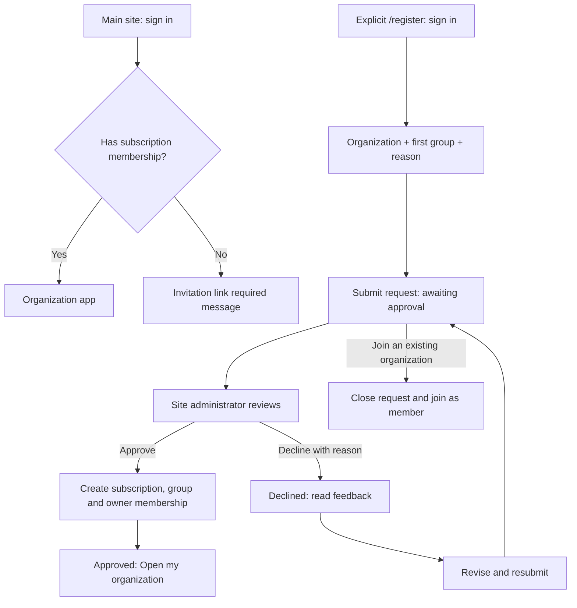

# Subscription onboarding UX

The main site is for invited members. New organizations apply through the explicit
`/register` URL. A site administrator reviews their reason before a subscription
or membership is created. Existing subscriptions stay active.

## Screens and actions

| Surface | Content | Actions |
| --- | --- | --- |
| Main site, signed out | Google sign-in | Sign in |
| Main site, signed in without membership | “You need an invitation link.” Ask the organization's administrator for a link. Show signed-in email. No registration link, promotion or subscription creation option. | Sign out to use another account. Site operators can access Site administration. |
| `/register`, signed out | “Request a new subscription.” Explain that a site administrator must review it. | Sign in with Google; Back to main page |
| `/register`, new applicant | Signed-in email; organization name; first group name; “Why do you need a subscription?” required multiline input. Help text asks who the organization serves, which costumes it manages, and how it plans to use the application. | Submit for approval; Back to main page; Sign out |
| `/register`, pending | “Your request is awaiting approval.” Explain that access starts after approval and to return to this page for the result. Display submitted organization, group, explanation and date. | Check status; Back to main page; Sign out |
| `/register`, declined | “Your request was declined.” Show the administrator's feedback and submitted details. | Revise and resubmit; Back to main page; Sign out |
| `/register`, revising | Prefill organization, group and explanation from the latest request. The next submission starts a new revision. | Submit for approval; Cancel changes |
| `/register`, approved | “Your subscription is approved.” Organization is ready to build its catalog and invite members. | Open my organization, leading to `/administration` |
| `/register`, existing member without application | “You already belong to an organization.” | Open my organization |
| `/register`, request closed by invitation join | Explain that the request closed because the applicant joined an existing organization. | Open my organization |
| `/site-admin`, Subscription requests | Default tab. Status filters: Awaiting review, Approved, Declined, Closed. Paginated queue shows organization, applicant/email, submitted date and status. | Review request/View request; Refresh requests; Load more requests |
| Administrator review dialog | Full organization, first group, applicant/email, date and unabridged explanation. Reviewed requests show feedback and are read-only. | Approve request; Decline request; Close |
| Approval confirmation | Explain that approval creates the named subscription and first group and makes the named applicant its owner with immediate access. | Confirm approval; Back to review |
| Decline confirmation | Required reason for declining; explain that the applicant will see it and can resubmit. | Confirm decline; Back to review |

## Behavior and recovery

- Request details load before a form is offered, preventing accidental duplicate
  applications. Each account may have one pending application.
- Organization and group names allow up to 200 characters; explanations and
  decline feedback allow up to 2,000. Required fields reject blank text. Textarea
  character counters and field-specific errors help users correct inputs.
- Submission failures keep entered fields visible and preserve their values.
  Status-load failures show an error and Try again. Successful submission shows
  the pending screen, even if the subsequent status refresh fails.
- Applicants check status explicitly; no email or push notification is promised.
  Approval grants access through the normal shared authentication/profile state.
- Administrator queues show loading states, inline errors and explicit empty-state
  copy. Decisions disable controls while saving. Success removes the request
  from the pending queue; it appears in its new status filter.
- Stale or already reviewed applications return a readable error and Refresh
  queue action. The administrator cannot approve a different resubmission from
  an old dialog. Repeated clicks cannot create multiple subscriptions.
- Decline and approval races produce one decision. Approval and invitation-join
  races produce one organization membership. Joining via an invitation closes a
  pending application atomically; an outdated review cannot subsequently approve it.
- Main-site navigation does not advertise `/register`, even for pending applicants.
  Their submission status is available by returning to the explicit URL.
- Desktop uses tables and a segmented status filter. Mobile uses request cards,
  a compact status selector, large touch controls, wrapped explanations and
  responsive review dialogs. No tenant navigation appears before membership.

## Authorization and data

`registerSubscription` now stores `subscriptionRequests/{uid}` rather than
creating a subscription. Applicant identity comes from callable authentication;
clients cannot select another applicant or supply review/role fields.
`getMySubscriptionRequest` returns only the caller's application.

Only the live `siteAdmin: true` Auth claim authorizes `listSubscriptionRequests`
and `reviewSubscriptionRequest`. Approval transactionally creates the
subscription, first group and owner's user document, sets the request to approved,
and appends an audit snapshot. Decline requires feedback and grants no access.
Review decisions require a matching pending revision. Existing tenant permissions
stay in place; no pending tenant data is exposed through Firestore rules.

Resubmission replaces the latest application document and increments its revision.
Previous review decisions, reasons and reviewed request details remain in
`siteAdminHistory` for deployer inspection through the Firebase Console.

Deploy the updated callables with the web app and provision a site administrator
before accepting requests. The previous registration client cannot submit without
the now-required explanation. There is no retroactive approval requirement for
existing subscriptions.
